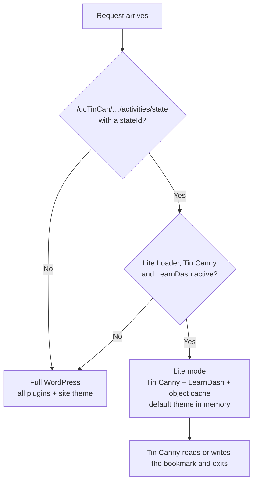

# Lite Loader for Tin Canny

**Make LearnDash sites with Tin Canny fast again when a class is online.**

iSpring, Articulate Storyline and Adobe Captivate modules save the learner's resume bookmark to [Tin Canny LearnDash Reporting](https://www.uncannyowl.com/downloads/tin-canny-reporting/) every few seconds. Each of those saves is a full WordPress request: every active plugin and the site theme load, even though Tin Canny only needs LearnDash to answer it.

This plugin makes those bookmark requests load **only Tin Canny, LearnDash and your object cache plugin**. Everything else on the site keeps working exactly as before.

| Bookmark save (`activities/state`) | Before | With Lite Loader |
| --- | --- | --- |
| Response time | 1.3 – 2.6 s | **0.26 – 0.45 s** |
| Memory | 112 MB | **12 MB** |
| CPU time | ~1.0 – 1.7 s | **~0.2 s** |

*Measured on a production LMS (LearnDash, Tin Canny, BuddyBoss, WooCommerce, Elementor, ~50 active plugins, 4 vCPU), from the PHP-FPM access log.*

---

## The problem

A learner with a module open sends a `PUT /ucTinCan/.../activities/state` request roughly every 6 seconds. With 100 learners in a live class that is about 17 requests per second, every one of them booting the whole site.

On the site above, during the evening class:

- bookmark saves were **~61 % of all PHP time**, and Tin Canny traffic as a whole ~68 %;
- the pages learners actually look at (courses, lessons) were **under 5 %**;
- every few minutes the server ran out of CPU, PHP workers queued, and **every page took 20 – 45 seconds**.

The fix is not more servers: those requests simply do not need BuddyBoss, WooCommerce, Elementor, SEO or analytics plugins.

## How it works



WordPress reads the list of active plugins **before** it loads any regular plugin, so a regular plugin cannot stop others from loading. Must-use plugins load earlier. On activation, Lite Loader copies a small loader into `wp-content/mu-plugins/`; on deactivation it removes it.

For a matching request, the loader filters `option_active_plugins` in memory, for that request only. Nothing is written to the database, and the plugin blocks any attempt to save the trimmed list.

### Why only `activities/state`

In Tin Canny's `Server.php`, a request with a `stateId` is answered inside `by_request()` → `get_state()`, which ends with `die`. It never reaches `create_tincan_record()` or `learndash_process_mark_complete()`, so no lesson is completed and no completion hook fires. The state code only calls LearnDash functions.

**Statements** (`/ucTinCan/.../statements`) are different: they can complete lessons, which fires LearnDash hooks that BuddyBoss, Zapier, certificate builders and other plugins listen to. Lite Loader **always loads the full site for statements**.

## What is and is not affected

| Request | Lite mode? |
| --- | --- |
| `/ucTinCan/.../activities/state?stateId=…` (bookmark read/write) | ✅ Yes |
| `/ucTinCan/.../statements` (xAPI statements, completions) | ❌ No, full site |
| Every page, wp-admin, AJAX, REST API, cron, WP-CLI | ❌ No, full site |

## Requirements

- WordPress 6.0+ and PHP 7.4+
- [LearnDash](https://www.learndash.com/) and [Tin Canny LearnDash Reporting](https://www.uncannyowl.com/downloads/tin-canny-reporting/), both active
- Write access to `wp-content/mu-plugins/` (the plugin creates the folder if needed)
- A default theme installed, for example Twenty Twenty-Five. It only needs to be installed, not active.

Tested with WordPress 7.1, PHP 8.2, LearnDash 5.2, Tin Canny 5.2, Object Cache Pro 1.25 and iSpring content.

## Installation

> **Test on a staging copy first.** It takes ten minutes and it is the learners' progress.

1. Download `lite-loader-for-tin-canny.zip` from the [latest release](../../releases/latest).
2. In wp-admin, go to **Plugins → Add New → Upload Plugin**, upload the zip and activate it.
3. Go to **Tools → Tin Canny Lite Loader** and check that the loader status is *Installed and up to date*.

## Checking that it works

1. Open a module as a learner and move through a few slides.
2. In the browser's developer tools, open the **Network** tab and filter by `state`. Select a `PUT` request: the response headers include `X-Lite-Loader`, and the time should drop clearly.
3. Reload the page. The module must resume on the slide where you left it.
4. Check the PHP error log for new errors.

If you have SSH access and a PHP-FPM access log with timings (as on Cloudways), you can compare duration, memory and CPU per request before and after.

## Settings

**Tools → Tin Canny Lite Loader**

- **Lite mode**: on or off.
- **Plugins to load**: Tin Canny and LearnDash are always loaded. Object cache plugins (Object Cache Pro, Redis Object Cache and similar) are selected by default. Add a plugin only if it hooks into Tin Canny's state handling, for example through the `tincanny_process_state` or `uo_tincanny_by_request_url` filters.
- **Theme for these requests**: a default theme is the lightest choice, and it avoids errors from themes such as BuddyBoss Theme that depend on plugins that are not loaded. Nothing is ever displayed in these requests.

## Turning it off

- Deactivate the plugin, or untick **Lite mode**.
- Without wp-admin access, add this to `wp-config.php`:

  ```php
  define( 'LLFTC_DISABLE', true );
  ```

- Or delete `wp-content/mu-plugins/lite-loader-for-tin-canny-loader.php`.

## Safety measures

- Only acts when Lite Loader, Tin Canny and LearnDash are all active. Tin Canny and LearnDash are enforced in the loader itself, whatever the settings say.
- Never runs for wp-admin, cron or WP-CLI.
- Blocks any attempt to save the trimmed plugin list during a lite request.
- Never overwrites a file in `mu-plugins/` that it did not create.
- Reinstalls its loader if it goes missing or after an update.

## Limitations

- Not tested on multisite. Network-activated plugins are not filtered.
- Detects Tin Canny and LearnDash by their default folder names (`tin-canny-learndash-reporting`, `sfwd-lms`).
- Built and tested against Tin Canny 5.2. If a future version changes how state requests are handled, test again before updating.

## Also check OPcache

On the same site, the other half of the problem was **OPcache running full**. With the default 128 MB and ~27,000 PHP files across all plugins, only about half of the code fit, and the hit rate was 56 %. Large LMS stacks usually need something like:

```ini
opcache.memory_consumption = 512
opcache.interned_strings_buffer = 64
opcache.max_accelerated_files = 50000
```

Check `opcache_get_status()` from PHP-FPM (not the CLI): `cache_full` should be `false` and the hit rate above 99 %.

## Contributing

Issues and pull requests are welcome, especially test reports with other Tin Canny versions, Articulate or Captivate content, and multisite.

## Disclaimer

This is an independent project. It is not affiliated with or endorsed by Uncanny Owl or LearnDash. Tin Canny LearnDash Reporting and LearnDash are trademarks of their respective owners.

## License

[GPL-2.0-or-later](LICENSE), the same license as WordPress.

---

### En español

**Lite Loader for Tin Canny** acelera los sitios LearnDash que usan Tin Canny con contenido iSpring, Articulate o Captivate. Esas presentaciones guardan el marcador de reanudación cada ~6 segundos, y cada guardado carga WordPress completo con todos sus plugins. Este plugin hace que esas peticiones carguen solo Tin Canny, LearnDash y la caché de objetos: en un LMS real, cada guardado pasó de 1,3–2,6 s a 0,26–0,45 s, y de 112 MB a 12 MB de memoria. Los statements, las finalizaciones de lecciones y el resto del sitio no cambian. Pruébalo primero en un staging.
